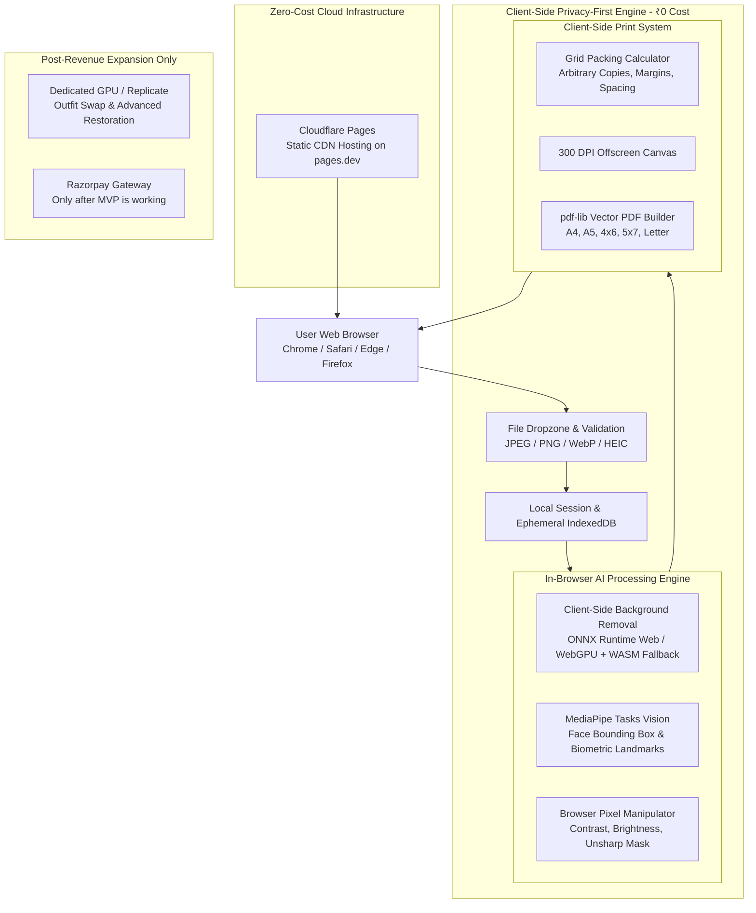
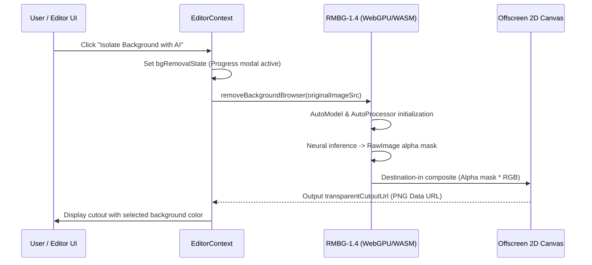

# Technical Documentation - AI Passport Photo Maker

> Comprehensive architecture specification, mathematical models, data schemas, and pipeline workflows for the AI Passport Photo Maker application.
> **Guiding Principle:** Zero-Cost Development Strategy (₹500 Initial Budget) utilizing Client-Side WebGPU/WASM AI, MediaPipe, and HTML5 Canvas processing with zero paid API dependencies for the core MVP.

---

## 1. Executive System Overview & Zero-Cost Strategy

The AI Passport Photo Maker is engineered as an ultra-high performance, privacy-first biometric photo studio web application. To adhere strictly to our **₹500 INR initial budget**, the architecture departs from costly per-image server APIs and instead executes all primary image intelligence directly inside the client's browser:

1. **Client-Side Background Removal:** Browser-compatible neural models (ONNX Runtime Web / WebGPU with CPU WASM fallback) running locally on the user's device for ₹0 per execution.
2. **Client-Side Face Detection:** Google MediaPipe Tasks Vision (`@mediapipe/tasks-vision`) extracting biometric facial landmarks and centering coordinates with 0ms server latency and ₹0 cost.
3. **Client-Side Photo Enhancement:** Canvas-based tone correction, gamma balance, and unsharp masking sharpness filters without misleading claims.
4. **100% Privacy by Design:** Photos never leave the user's device unless explicitly requested. No permanent cloud storage by default. Full "Clear All Data" control.
5. **Zero-Cost Custom Print Engine:** Vector PDF generation powered by `pdf-lib` and HTML5 Canvas running entirely in-browser, supporting arbitrary copy counts, customizable margins, spacing, and cutting guides.
6. **Free Production Hosting:** Cloudflare Pages deployment via free `pages.dev` subdomain with unlimited bandwidth and zero server costs.

---

## 2. Zero-Cost System Architecture

---

## 3. Image Processing & Biometric Mathematics

### 3.1 DPI and Physical-to-Pixel Conversion
Physical passport dimensions are universally standardized in millimeters ($mm$) or inches ($in$). High-quality photographic printing mandates **300 Dots Per Inch (DPI)**:

$$\text{Pixels} = \left(\frac{\text{Millimeters}}{25.4}\right) \times 300$$

$$\text{Pixels} = \text{Inches} \times 300$$

#### Reference Standard Dimensions at 300 DPI
| Country / Region | Document | Physical Size | Aspect Ratio | Exact Pixels (300 DPI) | Target Head Height % |
|---|---|---|---|---|---|
| **United States** | Passport / Visa | $2 \times 2\text{ in } (50.8 \times 50.8\text{ mm})$ | 1:1 | $600 \times 600\text{ px}$ | $50\% - 69\%$ ($1.0 - 1.375\text{ in}$) |
| **United Kingdom** | Passport | $35 \times 45\text{ mm}$ | 7:9 | $413 \times 531\text{ px}$ | $64\% - 75\%$ ($29 - 34\text{ mm}$) |
| **India** | Passport / OCI | $50.8 \times 50.8\text{ mm}$ / $35 \times 45\text{ mm}$ | 1:1 or 7:9 | $600 \times 600\text{ px}$ / $413 \times 531\text{ px}$ | $60\% - 70\%$ |
| **European Union / Schengen** | Visa / ID | $35 \times 45\text{ mm}$ | 7:9 | $413 \times 531\text{ px}$ | $70\% - 80\%$ ($32 - 36\text{ mm}$) |
| **Canada** | Passport | $50 \times 70\text{ mm}$ | 5:7 | $591 \times 827\text{ px}$ | $44\% - 51\%$ ($31 - 36\text{ mm}$) |
| **Australia** | Passport | $35 \times 45\text{ mm}$ | 7:9 | $413 \times 531\text{ px}$ | $71\% - 80\%$ ($32 - 36\text{ mm}$) |
| **China** | Passport | $33 \times 48\text{ mm}$ | 11:16 | $390 \times 567\text{ px}$ | $58\% - 69\%$ ($28 - 33\text{ mm}$) |

### 3.2 Biometric Head Positioning & Auto-Cropping Algorithm
The ICAO guidelines dictate:
1. **Vertical Centering:** The vertical midline dividing the face between both eyes and through the nose tip must sit precisely at $50\%$ of the canvas width.
2. **Eye Line Elevation:** The eye plane must be positioned between $55\%$ and $65\%$ from the bottom of the canvas (or $35\% - 45\%$ from the top).
3. **Head Height Fraction:** The distance from the lower edge of the chin to the top of the skull must occupy between $H_{\min}$ and $H_{\max}$ of the total frame height.

Given MediaPipe landmark detection:
- Eye midpoint $Y_{\text{eye}} = \frac{Y_{\text{leftEye}} + Y_{\text{rightEye}}}{2}$
- Chin position $Y_{\text{chin}}$
- Estimated skull crown $Y_{\text{crown}} = Y_{\text{eye}} - (Y_{\text{chin}} - Y_{\text{eye}}) \times 1.1$
- Measured head height $H_{\text{head}} = Y_{\text{chin}} - Y_{\text{crown}}$
- Required canvas crop height:

$$H_{\text{crop}} = \frac{H_{\text{head}}}{\text{TargetHeadRatio}}$$

$$W_{\text{crop}} = H_{\text{crop}} \times \left(\frac{W_{\text{mm}}}{H_{\text{mm}}}\right)$$

---

## 4. Custom Passport Photo Sheet Packing Algorithm (Pure Client-Side)

The custom photo sheet engine supports **arbitrary reasonable copy quantities** (e.g. 1, 2, 4, 6, 8, 12, or custom $N$) on any selected paper size without server computation:

### 4.1 Optimal Grid Layout Computation
Given:
- Paper dimensions: $W_{\text{paper}}$, $H_{\text{paper}}$ in millimeters.
- Photo dimensions: $W_{\text{photo}}$, $H_{\text{photo}}$ in millimeters.
- Margins: $M_{\text{top}}, M_{\text{bottom}}, M_{\text{left}}, M_{\text{right}}$ in millimeters (default $5\text{ mm}$).
- Inter-photo spacing: $S$ in millimeters (default $3\text{ mm}$).

$$\text{Cols}_{\max} = \left\lfloor \frac{W_{\text{available}} + S}{W_{\text{photo}} + S} \right\rfloor$$

$$\text{Rows}_{\max} = \left\lfloor \frac{H_{\text{available}} + S}{H_{\text{photo}} + S} \right\rfloor$$

$$\text{SheetCapacity} = \text{Cols}_{\max} \times \text{Rows}_{\max}$$

If user requests $N$ copies where $N > \text{SheetCapacity}$, the engine dynamically paginates across multiple pages in the generated PDF using `pdf-lib`.

---

## 5. Phase 4: AI Background Removal & Replacement Architecture

### 5.1 In-Browser Neural Engine (`briaai/RMBG-1.4`)
The primary background removal service operates entirely in the client browser utilizing `@huggingface/transformers` (Apache-2.0 license) with the `briaai/RMBG-1.4` neural segmentation model:
- **Zero API Incurred Cost:** Models run on client GPU via WebGPU API or fall back automatically to WebAssembly (WASM) multi-threaded CPU SIMD.
- **Privacy Guarantee:** The user's biometric photograph never leaves their local browser memory or network perimeter.
- **Sub-Pixel Hair Matting:** RMBG-1.4 generates a continuous 8-bit alpha channel ($0 \le \alpha \le 255$) that preserves fine hair strands, flyaways, translucent veils, and spectacles without harsh boundary cutoffs.

### 5.2 Pipeline Workflow

### 5.3 Compliant Background Color Palette
International civil aviation authorities prescribe exact background coloration:
| Color Name | Hex Code | Primary Jurisdictions & Standards |
|---|---|---|
| **Pure White** | `#FFFFFF` | US State Department, UK HMPO, Schengen Visa, India MEA, Canada Passport |
| **Light Blue** | `#B9D7EA` | Malaysia Immigration, Kuwait civil ID, GCC work permits |
| **Royal Blue** | `#1D4ED8` | Philippines DFA, Singapore student passes, ASEAN certifications |
| **Light Gray** | `#E5E7EB` | GCC residency, UAE ICP, German Bundespersonalausweis |
| **Red** | `#C4151C` | Indonesian passport, official work visas |
| **Transparent** | `transparent` | Graphic design, custom composites, clean PNG export |
| **Custom Palette** | `#xxxxxx` | User-selected via native color well or hex string input |

### 5.4 Non-Destructive Reversibility
- The original portrait remains immutable in `originalImageSrc`.
- Toggling back to "Original BG" simply unsets `transparentCutoutUrl`, immediately reverting all canvas renderers without reload.
- The interactive Before-and-After slider enables simultaneous real-time comparison between original and cutout states.

### 5.5 Modular API Adapter Pattern (`/api/ai/remove-bg`)
The system features a pluggable server-side route for optional enterprise backends (`process.env.AI_BG_REMOVAL_PROVIDER`):
- `photoroom`: High-throughput production segmentation via Photoroom API.
- `replicate`: Cloud GPU BiRefNet neural segmentation via Replicate.
- `client_webgpu` (Default): Returns zero-cost in-browser instruction when no paid keys are present, maintaining strict compliance with the ₹500 budget constraint.

---

## 6. Phase 5: Biometric Face Detection & Auto-Cropping Engine

### 6.1 In-Browser Biometric Landmark Extraction
Biometric landmark detection is executed client-side via Google's `@mediapipe/tasks-vision` `FaceLandmarker` running on WebAssembly/WebGL with zero paid API overhead:
- **Biometric Landmarks Extracted:**
  - Eyes: Left iris / pupil ($P_{\text{eye\_left}}$) and right iris / pupil ($P_{\text{eye\_right}}$).
  - Inter-ocular Eye Center: $P_{\text{eye\_center}} = \frac{P_{\text{eye\_left}} + P_{\text{eye\_right}}}{2}$.
  - Menton (Bottom of Chin): MediaPipe vertex 152 ($P_{\text{chin}}$).
  - Hair Crown (Top of Head): Derived from vertex 10 with anatomical cranial compensation ($P_{\text{crown}}$).
  - Tragus (Left & Right Ear): Vertices 234 and 454.
  - Head Roll / Tilt Angle: $\theta_{\text{roll}} = \arctan\left(\frac{y_{\text{right}} - y_{\text{left}}}{x_{\text{right}} - x_{\text{left}}}\right) \times \frac{180}{\pi}$.

### 6.2 Mathematical Auto-Crop Formulation (ICAO Doc 9303)
Given target crop dimensions $W_{\text{crop}}, H_{\text{crop}}$ in pixels (e.g. $600 \times 600\text{ px}$ at 300 DPI for US; $413 \times 531\text{ px}$ for UK/EU):

1. **Target Head Height Ratio:**
   $$R_{\text{target\_head}} = \frac{\text{MinHeadPct} + \text{MaxHeadPct}}{2}$$
   $$H_{\text{target\_head\_px}} = H_{\text{crop}} \times R_{\text{target\_head}}$$

2. **Optimal Zoom Scale ($Z$):**
   $$Z = \frac{H_{\text{target\_head\_px}}}{H_{\text{source\_head\_at\_zoom1}}}$$
   Clamped within $0.5 \le Z \le 3.0$.

3. **Horizontal Midline Centering ($\text{Pan}_X$):**
   $$\text{Pan}_{X} = -(x_{\text{eye\_center}} - 0.5) \times W_{\text{draw}} \times Z \times \left(\frac{W_{\text{display}}}{W_{\text{crop}}}\right)$$

4. **Vertical Eye-Plane Alignment ($\text{Pan}_Y$):**
   Let $Y_{\text{target\_eye}}$ be the required eye plane distance from the bottom edge of the photo (e.g. $59\%$ for US, $58\%$ for UK):
   $$Y_{\text{target\_eye\_top}} = H_{\text{crop}} \times (1 - Y_{\text{target\_eye}})$$
   $$\text{Pan}_{Y} = \left[ Y_{\text{target\_eye\_top}} - \left(\frac{H_{\text{crop}}}{2} + (y_{\text{eye\_center}} - 0.5) \times H_{\text{draw}} \times Z\right) \right] \times \left(\frac{H_{\text{display}}}{H_{\text{crop}}}\right)$$

5. **Deskew Rotation ($\Delta\theta$):**
   $$\Delta\theta = -\theta_{\text{roll}}$$

### 6.3 5-Point Biometric Compliance Evaluation
Every active crop is scored $0 - 100\text{ PTS}$ across 5 core criteria:
1. **Face Presence:** Verification of exactly 1 detected human face.
2. **Head Pose & Tilt:** Pass if $|\theta| \le 3.0^\circ$; Warning if $3.0^\circ < |\theta| \le 5.0^\circ$; Fail if $|\theta| > 5.0^\circ$.
3. **Head Height Coverage:** Pass if $R_{\text{min}} \le R_{\text{current}} \le R_{\text{max}}$.
4. **Facial Centering:** Pass if horizontal offset ratio $\le 0.05$.
5. **Resolution & 300 DPI Density:** Pass if image dimensions exceed required 300 DPI pixel dimensions.

---

## 7. Privacy & Data Handling Policy

1. **Zero Server Uploads by Default:** All photo operations occur directly inside browser memory via Web Workers, WebGPU, and Canvas.
2. **Local Session Storage:** Session data is held ephemerally. Closing the tab or clicking "Clear Photo Data" purges all active buffers.
3. **Transparent Disclaimer:** No biometric facial recognition profiles are stored or harvested.

---

## 8. Budget & Cost Breakdown (Strict ₹500 Constraint)

| Component | Architecture Choice | Cost |
|---|---|---|
| **Development & IDE** | Google Antigravity Free Plan | ₹0 |
| **Frontend Framework** | Next.js 14 + TypeScript | ₹0 (Open Source) |
| **Styling & UI** | Tailwind CSS + Lucide Icons | ₹0 (Open Source) |
| **Hosting & CDN** | Cloudflare Pages (`pages.dev`) | ₹0 (Free Tier) |
| **Background Removal** | Client-Side ONNX / WebGPU / WASM | ₹0 (Client compute) |
| **Face Detection** | MediaPipe Tasks Vision | ₹0 (Client compute) |
| **PDF Generation** | `pdf-lib` Client-Side | ₹0 (Open Source) |
| **Database (MVP)** | In-Browser Ephemeral Storage | ₹0 |
| **Payment Gateway (Post-MVP)** | Razorpay Standard Account | ₹0 setup (per-transaction % only) |
| **Total Initial Spend** | | **₹0 (100% within ₹500 budget)** |
